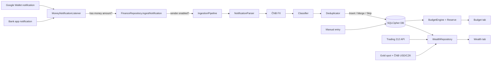

# Architecture

## Modules

```
VaultFlow/
├── core/domain/      Pure Kotlin. All business rules + unit tests. No Android.
│   ├── budget/       BudgetEngine (budget vs actual), Reserve (balance-based floor)
│   ├── ingest/       AmountParser, NotificationParser, Deduplicator, IngestionPipeline
│   ├── classify/     Classifier (own accounts → learned rules → built-in merchants)
│   ├── wealth/       NetWorth pillars, GoldMath
│   ├── fx/           ČNB daily-rate parser
│   ├── backup/       BackupCrypto (PBKDF2 + AES-256-GCM)
│   ├── demo/         Deterministic synthetic data
│   └── model/        Category, Transaction, Account, ...
└── app/              Android: security, persistence, network, UI
    ├── core/security/   KeystoreCipher, DatabaseKeyManager, SecretVault, AppPreferences
    ├── data/local/      Room entities/DAOs, SQLCipher VaultDatabase, mappers
    ├── data/remote/     Trading 212, gold spot (xaus.com), ČNB clients (OkHttp)
    ├── data/repository/ FinanceRepository, WealthRepository, SettingsStore, BackupManager
    ├── data/demo/       DemoSeeder (in-memory DB)
    ├── ingestion/       MoneyNotificationListener (NotificationListenerService)
    ├── di/              AppContainer (manual DI)
    └── ui/              Compose: lock, budget, wealth, settings, components, theme
```

Keeping the rules in `core/domain` means the logic that touches money
(parsing, de-duplication, reserve math) is covered by fast JVM tests and
can be reviewed without Android knowledge.

## Data flow



## Key decisions

| Decision | Why |
|---|---|
| Notification listener instead of bank APIs | Free, works for every Czech bank and Google Wallet, no PSD2 licence. Trade-off: depends on notification wording, so parsing is bank-agnostic and the capture log shows what happened. |
| Reserve = balance check, not an expense | `safe = liquid − floor − remaining budget`. Subtracting 5 000 every month (as in the first draft) double-counts the reserve. |
| Accounts use an *anchor balance* | Notifications carry transactions, not balances. You confirm a balance once and the app adds captured transactions on top. Re-anchor any time. |
| Dedup only across different apps | Wallet + bank report of one payment merge; two identical coffees from the same app don't. |
| On-device classifier, no LLM | Transactions never leave the phone; $0 running cost. Learned rules cover the long tail. |
| Keystore AES-GCM instead of `security-crypto` | The Jetpack library is deprecated; the platform API is stable. |
| DB key not biometric-bound | The listener has to write while the UI is locked. |
| No destructive migrations | A schema change must never wipe financial history. Schemas are exported to `app/schemas/`. |
| Manual DI | Small graph, zero annotation processing beyond Room; easy to read. |
| Money as `Long` minor units | No floating-point rounding errors. |

## Testing

- `./gradlew :core:domain:test`: domain unit tests (parsers, dedup, classifier,
  budget/reserve, FX, crypto, demo data).
- CI (`.github/workflows/ci.yml`) runs the tests, builds the debug APK and
  scans the full git history with gitleaks on every push.
