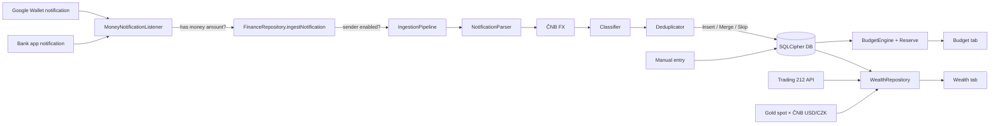

# Architecture

## Modules

```
VaultFlow/
├── core/domain/      Pure Kotlin. All business rules + unit tests. No Android.
│   ├── budget/       BudgetEngine (budget vs actual), Reserve (balance-based floor)
│   ├── ingest/       AmountParser, NotificationParser, BankMessageParser + PaymentDetails,
│   │                 Deduplicator, IngestionPipeline, EmailFirst, Reenricher, DuplicateRepair
│   ├── classify/     Classifier (own accounts → your rules → payment-message keywords → learned rules
│   │                 → dictionary → context; then: paid abroad → Holiday), Abroad,
│   │                 CategoryDictionary (data files in resources/.../classify/dictionary/*.tsv),
│   │                 MerchantNormalizer, CategoryDictionary, RuleLearning
│   ├── wealth/       NetWorth pillars, GoldMath
│   ├── fx/           ČNB daily-rate parser
│   ├── backup/       BackupCrypto (PBKDF2 + AES-256-GCM)
│   ├── demo/         Deterministic synthetic data
│   └── model/        Category, Transaction, Account, ...
└── app/              Android: security, persistence, network, UI
    ├── core/security/   KeystoreCipher, DatabaseKeyManager, SecretVault, AppPreferences
    ├── data/local/      Room entities/DAOs, SQLCipher VaultDatabase, mappers
    ├── data/remote/     Trading 212, gold spot (xaus.com), ČNB clients (OkHttp)
    ├── data/repository/ FinanceRepository, WealthRepository, SettingsStore, BackupManager
    ├── data/demo/       DemoSeeder (in-memory DB)
    ├── ingestion/       MoneyNotificationListener (NotificationListenerService)
    ├── di/              AppContainer (manual DI)
    └── ui/              Compose: lock, budget, wealth, settings, components, theme
```

Keeping the rules in `core/domain` means the logic that touches money
(parsing, de-duplication, reserve math) is covered by fast JVM tests and
can be reviewed without Android knowledge.

## Data flow



## Key decisions

| Decision | Why |
|---|---|
| Notification listener instead of bank APIs | Free, works for every Czech bank and Google Wallet, no PSD2 licence. Trade-off: depends on notification wording, so parsing is bank-agnostic and the capture log shows what happened. |
| Reserve = balance check, not an expense | `safe = liquid − floor − remaining budget`. Subtracting 5 000 every month (as in the first draft) double-counts the reserve. |
| Accounts use an *anchor balance* | Notifications carry transactions, not balances. You confirm a balance once and the app adds captured transactions on top. Re-anchor any time. |
| Dedup only across different apps | Wallet + bank report of one payment merge; two identical coffees from the same app don't. |
| Every fused message is remembered | A record keeps the fingerprints of ALL messages fused into it, so a replay (re-delivered notification, e-mail fetched again after a restore) is recognised, not only a replay of the first report. |
| Time as a range | A date-only bank e-mail ("ze dne 10. 11.") is matched to its stated day up to its arrival, so an e-mail hours late still confirms its payment, and never a payment from another day. |
| Transfers linked by fingerprint | The counterpart of message X carries `X:mirror`; a record that started as a counterpart links back to X, so later reports never create a second counterpart. A card payment at a shop or a stranger's payment never confirms an expected transfer. |
| On-device classifier, no LLM | Transactions never leave the phone; $0 running cost. Learned rules cover the long tail. See `LLM_CLASSIFIER_ANALYSIS.md`. |
| E-mail first | A push books the money at once; for accounts whose bank e-mails every payment it is provisional ("awaiting e-mail") until the e-mail names it (shop, counterparty or payment message), adds the description, counterparty account and symbols, and re-classifies. The wait times out (default 3 h). |
| Name by information, not by source | Generic bank titles rank 0; e-mail > Wallet > push; a Wallet brand beats the e-mail descriptor of the same shop. Each record stores where its name came from (`nameSource`). |
| Dictionary as data files | ~1,850 shops, companies and words (Czech, French, German, international; words in Czech, English, French, German) in plain `.tsv` files, one per country plus words, payment messages and income. Adding a shop is a one-line change; tests check every entry and ~200 realistic terminal names. Matching uses a prefix index (one pass per text), so the size does not slow capture down. |
| Paid abroad → Holiday | A shop that exists only abroad (flag `abroad`: E.Leclerc, SNCF, Rewe, "boulangerie", "péage"), or two hints (foreign currency, foreign town, country code, foreign legal form), or a known shop paid in a foreign currency, is Holiday. One hint alone is a suggestion. Online services (flag `online`) and anything naming a Czech town are never abroad; transfers to someone's account neither. |
| First names are not shops | Brands that are also names (flag `person`: Albert, Paul, Penny, Müller) are ignored for transfers to a person and rank below a word that names the kind of shop ("Bäckerei Müller" is a bakery). |
| Your category is a lock | `categoryLocked` (DB v6) instead of the note text: no report, rule or re-check changes it. |
| Payment message classifies | "padel", "nájem", "obědy" in the message decide the category (0.9); rules also match the counterparty account, so a rule on a friend's account keeps working when the e-mail names the payment differently. |
| Guesses are applied but flagged | A result below 0.8 confidence keeps its category with low confidence and appears under *Quick review*; nothing matched = Uncertain. Two consistent corrections of a merchant make a trusted learned rule; "always" makes one immediately. |
| Keystore AES-GCM instead of `security-crypto` | The Jetpack library is deprecated; the platform API is stable. |
| DB key not biometric-bound | The listener has to write while the UI is locked. |
| No destructive migrations | A schema change must never wipe financial history. Schemas are exported to `app/schemas/`. |
| Manual DI | Small graph, zero annotation processing beyond Room; easy to read. |
| Money as `Long` minor units | No floating-point rounding errors. |

## De-duplication: what is decided how

| Situation | Decision |
|---|---|
| Same message again (re-post with the same key, restore, re-fetch) | Skipped: its fingerprint is known |
| Bank app re-posts its notification (same id, same text, new time within 2 min) | Skipped |
| Push + Wallet + e-mail of one payment, any order, e-mail up to days late | One record |
| Date-only e-mail | The unconfirmed payment of its stated day closest before the e-mail arrived |
| Phone off: push delivered hours late (before or after the e-mail is fetched) | Merged with the e-mail-only record up to 12 h |
| Wallet re-posts (up to 90 min, other spelling) | Fold by name; never move a record's bank time |
| Two identical payments, each reported by the bank | Two records |
| Own transfer: interbank / card top-up | Counterpart within 7 days / within 3 h (on the e-mail's day) |
| Same amount, same account, within 3 min, names differ | One payment only when both times are exact (or a Wallet card report is involved): a date-only e-mail's time is its arrival, not the payment |
| A generic push title ("Odešla platba") and an exact-time e-mail, same account and amount | One payment within the e-mail window (a late push) |
| A push after a date-only e-mail that Wallet already joined | Still the late push of that payment |

Known limits (no matcher can know): two identical payments (same shop, amount, account) within
90 min that only Google Wallet reports become one; and when the same shop charges the same
amount twice within 12 h and one payment is known only from its date-only e-mail while the other
only from its push, they are treated as one payment reported twice (or a late push). Such pairs
appear on the Budget tab under *Possible duplicates* when they look like older duplicates.

`DedupPropertyTest` replays 1 200 random months (arrival order, late e-mail fetches, phone off,
re-delivered and re-fetched messages) and checks every account: one record per real payment,
correct total. `DedupScenarioMatrixTest` and `DedupRegressionTest` hold the concrete cases.

## Testing

- `./gradlew :core:domain:test`: domain unit tests (parsers, dedup, classifier,
  budget/reserve, FX, crypto, demo data).
- CI (`.github/workflows/ci.yml`) runs the tests, builds the debug APK and
  scans the full git history with gitleaks on every push.
